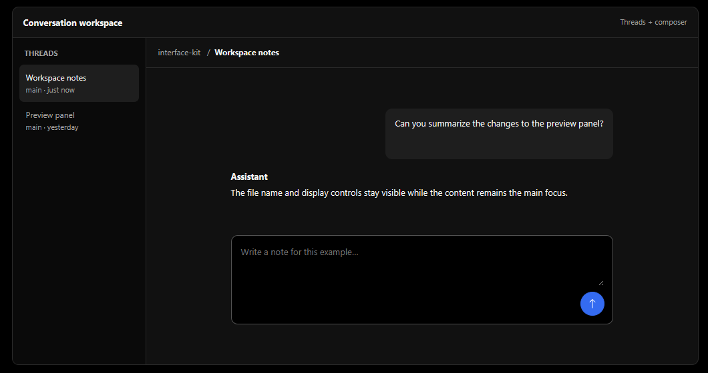

<h1 align="center">Teo T3 Code Design System</h1>

  
  
  

**I'm not Theo, I'm Teô!**

This is a design system I ~~copied~~ *created* based on the default theme of [T3 Code](https://github.com/pingdotgg/t3code). I liked its quiet surfaces, compact controls, and clear visual hierarchy, so I documented them as a reference for building other interfaces.

**Light and dark themes · Blue accents · Interactive layouts**

**[View the showcase](https://rteoo.com/design-system-t3code/)**

| Light | Dark |
| --- | --- |
|  |  |

I've made a few small tweaks and opinionated choices for more consistent general use, including a clearer dark surface hierarchy, semantic status colors, and guidelines for components and layouts. The original blue accent is used for highlights, focus, and primary actions.

This is an independent project, not affiliated with Theo. It's not an official T3 Code design system or a pixel-perfect specification of every T3 Code screen.

It was reconstructed from T3 Code v0.1.8, after some UI improvements made by the T3 Code team.

## Explore the system

- [Design system guide](index.html) — light and dark colors, typography, components, syntax highlighting, file previews, and accessibility notes.
- [Interactive layouts](layouts.html) — conversation, change review, and settings examples using the system. The examples use local, session-only demo data.
- [Design guidelines](DESIGN.md) — tokens, component rules, accessibility considerations, and the original T3 Code palette for reference.
- [Syntax reference](SYNTAX.md) — syntax highlighting and file preview details.

## Credits

Inspired by [T3 Code](https://github.com/pingdotgg/t3code) and its default theme. Interface icons use [Bootstrap Icons](https://github.com/twbs/icons). Both projects are MIT-licensed.

Bootstrap Icons license notice

The MIT License (MIT)

Copyright (c) 2019-2024 The Bootstrap Authors

Permission is hereby granted, free of charge, to any person obtaining a copy
of this software and associated documentation files (the "Software"), to deal
in the Software without restriction, including without limitation the rights
to use, copy, modify, merge, publish, distribute, sublicense, and/or sell
copies of the Software, and to permit persons to whom the Software is
furnished to do so, subject to the following conditions:

The above copyright notice and this permission notice shall be included in
all copies or substantial portions of the Software.

THE SOFTWARE IS PROVIDED "AS IS", WITHOUT WARRANTY OF ANY KIND, EXPRESS OR
IMPLIED, INCLUDING BUT NOT LIMITED TO THE WARRANTIES OF MERCHANTABILITY,
FITNESS FOR A PARTICULAR PURPOSE AND NONINFRINGEMENT. IN NO EVENT SHALL THE
AUTHORS OR COPYRIGHT HOLDERS BE LIABLE FOR ANY CLAIM, DAMAGES OR OTHER
LIABILITY, WHETHER IN AN ACTION OF CONTRACT, TORT OR OTHERWISE, ARISING FROM,
OUT OF OR IN CONNECTION WITH THE SOFTWARE OR THE USE OR OTHER DEALINGS IN
THE SOFTWARE.

