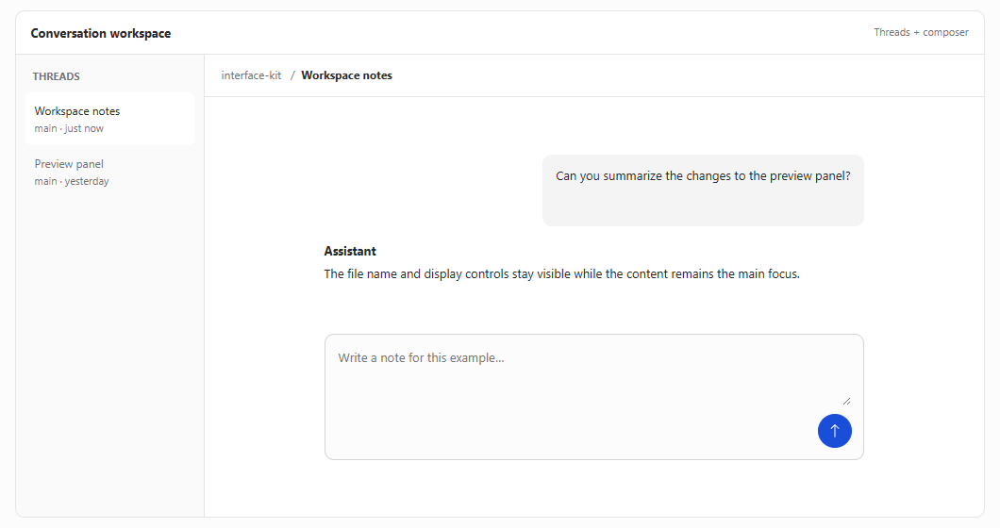

# Teo T3 Code Design System

**I'm not Theo, I'm Teô!**

This is a design system I ~~copied~~ *created* based on the default theme of [T3 Code](https://github.com/pingdotgg/t3code). I liked its quiet surfaces, compact controls, and clear visual hierarchy, so I documented them as a reference for building other interfaces.

**Light and dark themes · Blue accents · Interactive layouts**

| Light | Dark |
| --- | --- |
|  |  |

I've made a few small tweaks and opinionated choices for more consistent general use, including a clearer dark surface hierarchy, semantic status colors, and guidelines for components and layouts. The original blue accent is used for highlights, focus, and primary actions.

This is an independent project, not affiliated with Theo. It's not an official T3 Code design system or a pixel-perfect specification of every T3 Code screen.

It was reconstructed from T3 Code v0.1.8, after some UI improvements made by the T3 Code team.

## Explore the system

- [Design system guide](index.html) — light and dark colors, typography, components, syntax highlighting, file previews, and accessibility notes.
- [Interactive layouts](layouts.html) — conversation, change review, and settings examples using the system. The examples use local, session-only demo data.
- [Design guidelines](DESIGN.md) — tokens, component rules, accessibility considerations, and the original T3 Code palette for reference.
- [Syntax reference](SYNTAX.md) — syntax highlighting and file preview details.

## Credits

Inspired by [T3 Code](https://github.com/pingdotgg/t3code) and its default theme. Interface icons use [Bootstrap Icons](https://github.com/twbs/icons). Both projects are MIT-licensed.
